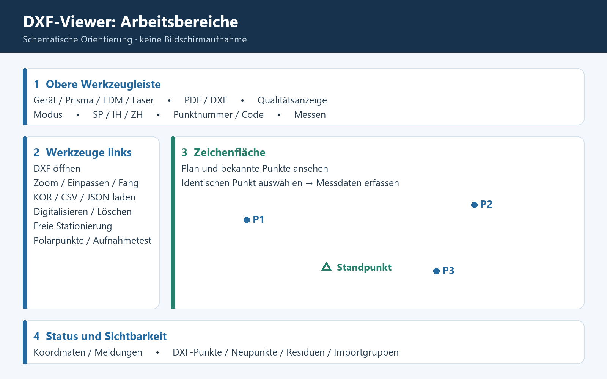
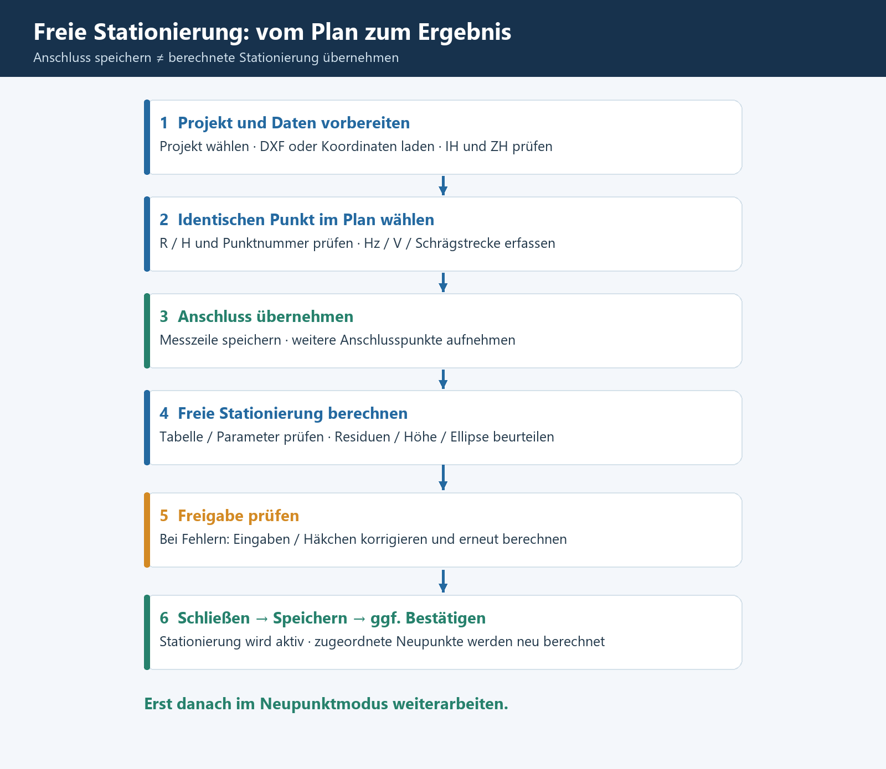
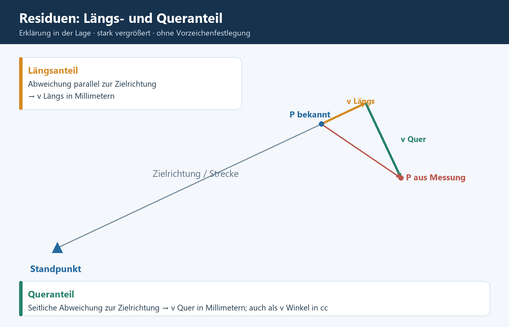
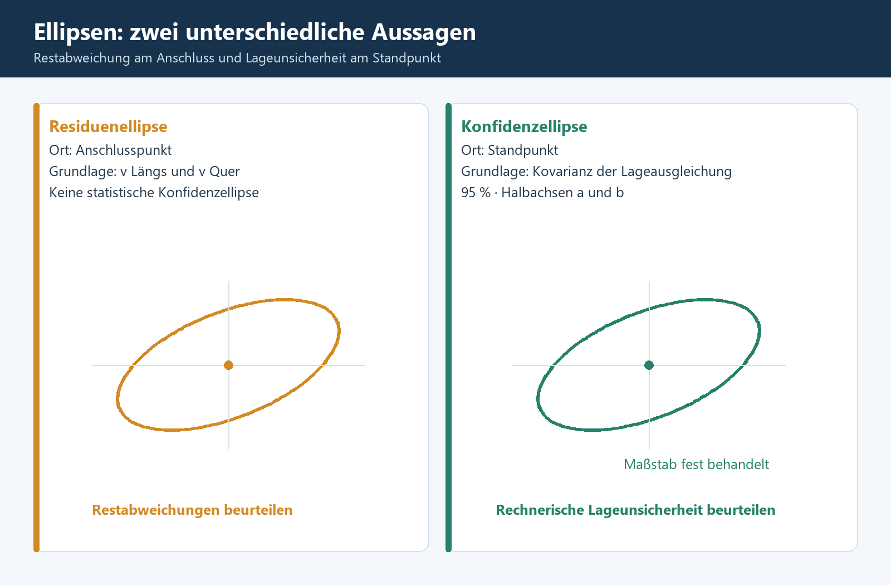

# Feldbuch-NT: DXF-Viewer und Freie Stationierung

**Benutzeranleitung · Arbeitsfassung 1.0 · 6. November 2026**

| Dokumentmerkmal | Stand |
| --- | --- |
| Softwaregrundlage | Feldbuch-NT 0.5.2, Build 34; gesicherter Quellstand vom 06.11.2026 |
| Schwerpunkt | Anschlusspunkte im Plan wählen, Messdaten erfassen, Freie Stationierung berechnen und übernehmen |
| Zielgruppe | Anwender mit vermessungstechnischen Grundkenntnissen |
| Prüfumfang | Quellcodeprüfung und isolierte Prüfung des Rechenkerns; kein vollständiger Bedien- oder Tachymetertest |
| Abbildungen | Erläuternde Schemata, keine Bildschirmfotos; Anordnung und Farben der Software können abweichen |
| Fortschreibung | Versionsabhängige Grenzen und Quellbezüge stehen gesammelt in Anhang A und B |

Diese Markdown-Datei ist die redaktionelle Grundlage. Die Bilder liegen im Unterordner `grafiken`, die Übungsdateien unter `beispieldaten`. Die Ordnerstruktur beim Entpacken beibehalten. Für eine spätere Word- oder PDF-Ausgabe wird derselbe Text verwendet; es muss keine zweite Anleitung parallel gepflegt werden.

## Inhalt

1. [Aufgabe und Grundbegriffe](#1-aufgabe-und-grundbegriffe)
2. [Arbeitsplatz vorbereiten](#2-arbeitsplatz-vorbereiten)
3. [DXF-Viewer bedienen](#3-dxf-viewer-bedienen)
4. [Pläne und Koordinaten laden](#4-pläne-und-koordinaten-laden)
5. [Anschlusspunkte im Plan erfassen](#5-anschlusspunkte-im-plan-erfassen)
6. [Freie Stationierung berechnen](#6-freie-stationierung-berechnen)
7. [Ergebnis und Qualität beurteilen](#7-ergebnis-und-qualität-beurteilen)
8. [Stationierung übernehmen und weiterarbeiten](#8-stationierung-übernehmen-und-weiterarbeiten)
9. [Übungsbeispiel ohne Tachymeter](#9-übungsbeispiel-ohne-tachymeter)
10. [Weitere Werkzeuge](#10-weitere-werkzeuge)
11. [DXF und PDF ausgeben](#11-dxf-und-pdf-ausgeben)
12. [Störungen und Abhilfe](#12-störungen-und-abhilfe)
13. [Anhang A: Grenzen des dokumentierten Stands](#anhang-a-grenzen-des-dokumentierten-stands)
14. [Anhang B: Hinweise zur Pflege](#anhang-b-hinweise-zur-pflege)

## 1. Aufgabe und Grundbegriffe

Der DXF-Viewer verbindet eine zweidimensionale Planansicht mit Mess- und Auswertefunktionen. Er zeigt eine DXF-Zeichnung, importierte Koordinaten, Standpunkte und gemessene Neupunkte. Ein im Plan gewählter Punkt kann als Anschluss für die Freie Stationierung erfasst werden.

Bei der Freien Stationierung sind die Koordinaten der Anschlusspunkte bekannt. Aus den vom unbekannten Standpunkt gemessenen Richtungen und Strecken berechnet das Programm die Standpunktlage und Orientierung. Bei verwendbaren Höhenanschlüssen wird zusätzlich die Standpunkthöhe bestimmt.

| Begriff | Bedeutung in dieser Anleitung |
| --- | --- |
| Standpunkt / SP | Standort des Tachymeters; besitzt eine eigene Standpunktnummer |
| Anschlusspunkt | Punkt mit bekannten Koordinaten, zu dem eine Messung vorliegt |
| Identischer Punkt | Derselbe physische Punkt im Plan und im Gelände |
| Neupunkt | Neu aufgenommener Punkt, dessen Koordinaten aus Messung und Stationierung entstehen |
| R / H | Rechtswert und Hochwert; beide in Metern |
| Höhe | Höhenkoordinate; nicht mit dem Hochwert H verwechseln |
| IH / ZH | Instrumentenhöhe über dem Standpunkt bzw. Zielhöhe über dem Zielpunkt |
| Hz | Unorientierte Horizontalrichtung in gon |
| V | Zenitwinkel in gon: 100 gon entspricht einer horizontalen Zielung |
| Strecke | Schrägstrecke in Metern; keine bereits horizontal reduzierte Strecke eingeben |
| Residuum | Restabweichung einer Beobachtung nach der Berechnung |

Ein Vollkreis entspricht 400 gon. Ein cc entspricht 0,0001 gon. Die Plan- und Koordinatendaten müssen dasselbe Koordinatensystem und die Einheit Meter verwenden. Der Viewer führt beim Laden keine automatische Umrechnung zwischen Koordinatensystemen aus.

## 2. Arbeitsplatz vorbereiten

1. Feldbuch-NT starten und im Hauptfenster das gewünschte Projekt auswählen beziehungsweise anlegen.
2. Projektname und Projektverzeichnis kontrollieren. Für die Übungen ein eigenes Testprojekt verwenden.
3. Für Messungen am Gerät zunächst die Kommunikation einrichten und die Verbindung prüfen. Die Einrichtung der jeweiligen Geräteschnittstelle ist nicht Gegenstand dieser Anleitung.
4. Die Rechenparameter prüfen, insbesondere freie/feste Maßstabsbehandlung, Höhenberechnung und Fehlergrenzen.
5. Im Hauptfenster **DXF-Viewer** öffnen.

Für die manuelle Eingabe und das Übungsbeispiel ist kein verbundenes Tachymeter erforderlich. Gerätefunktionen wie Messen, EDM-Umschaltung oder Laser setzen dagegen eine passende Verbindung und Unterstützung durch das Instrument voraus.

Vor der ersten Messung Standpunktnummer, IH, ZH, Zielart und Prismenkonstante kontrollieren. Eine passende grafische Darstellung ersetzt diese Prüfung nicht.

## 3. DXF-Viewer bedienen



*Abbildung 1: Funktionsbereiche des Viewers. Das Schema zeigt die Aufgaben der Bereiche, keine pixelgenaue Oberfläche.*

### 3.1 Bereiche und Eingabefelder

| Bereich / Feld | Verwendung |
| --- | --- |
| Obere Werkzeugleiste | Geräteeinstellungen, PDF-/DXF-Ausgabe, Qualitätsanzeige und Messfelder |
| Linke Werkzeugleiste | Datei laden, Zoom, Einpassen, Punktfang, Import und weitere Module |
| Zeichenfläche | Plan ansehen, verschieben und identische Punkte auswählen |
| Untere Statusleiste | Hinweise, Koordinaten und Sichtbarkeit von Punktgruppen und Residuen |
| SP | Nummer des verwendeten Standpunkts |
| IH | Instrumentenhöhe in Metern |
| ZH | Zielhöhe in Metern |
| Nr | Nummer des Ziel- oder Neupunkts |
| Code | Kennzeichnung des aufgenommenen Punkts |
| eL / eQ | Längs- und Querexzentrizität bei Neupunktmessungen |

Die Modi **Stationierung** und **Neupunkte** haben unterschiedliche Aufgaben. Im Stationierungsmodus wird der identische Punkt in der Zeichnung gewählt. Im Neupunktmodus steht die Messauslösung in der oberen Leiste zur Verfügung. Der Modusschalter wechselt zwischen beiden Aufgaben.

### 3.2 Maus und Navigation

| Aktion | Wirkung |
| --- | --- |
| Linke Maustaste gedrückt halten und ziehen | Ansicht verschieben; im Löschmodus stattdessen Auswahlfenster aufziehen |
| Mausrad über der Zeichenfläche | Normalerweise hinein- oder herauszoomen |
| Zoom + / Zoom − | Ansicht schrittweise vergrößern oder verkleinern |
| Einpassen | Sichtbare Inhalte in die Zeichenfläche einpassen |
| Linksklick auf ein auswählbares Objekt | Objekt beziehungsweise Punkt wählen; außerhalb des Digitalisierungsmodus kann der Messdatendialog aufgehen |
| Punktfang aktivieren | Einen angebotenen Geometriepunkt gezielt übernehmen |

**Besonderheit beim Mausrad:** Sind Residuen eingeblendet und Ellipsen vorhanden, verändert das Rad deren Vergrößerung statt des Ansichtszooms. Zum Zoomen dann die Zoomknöpfe verwenden oder die Residuen ausblenden. In der PDF-Ausschnittansicht dient das Mausrad dem Ansichtszoom.

Ein Klick ohne Punktfang kann einen nächstgelegenen Punkt auf einem Objekt liefern. Für einen Anschluss daher den Fangpunkt und die eingeblendeten Koordinaten prüfen. Ein beliebiger Punkt auf einer Linie ist nicht automatisch der gesuchte Vermessungspunkt.

## 4. Pläne und Koordinaten laden

### 4.1 DXF laden

1. Links **DXF-Datei öffnen** wählen.
2. Die DXF-Datei auswählen.
3. Mit **Einpassen** einen Überblick herstellen.
4. An bekannten Punkten prüfen, ob Rechtswert, Hochwert, Lage und Größenordnung stimmen.
5. Punktfang und gegebenenfalls die Anzeige **DXF-Punkte** einschalten.

Unterstützt sind LINE, CIRCLE, ARC, LWPOLYLINE, POINT, TEXT/MTEXT und INSERT in vereinfachter Form. Blockeinfügungen werden über ihren Einfügepunkt behandelt, nicht als vollständig aufgelöster Blockinhalt. Nicht unterstützte Objekte erscheinen möglicherweise nicht. Die Zeichnung wird als 2D-Grundlage verwendet; eine in der DXF enthaltene Z-Koordinate wird für den Anschluss nicht allgemein übernommen.

Der Punktindex kann DXF-Geometriepunkten automatisch Nummern zuordnen. Solche Nummern sind technische Zuordnungen des Viewers. Sie müssen nicht den amtlichen oder im Plan beschrifteten Punktnummern entsprechen. Im Messdatendialog ist die Punktnummer deshalb ausdrücklich zu kontrollieren.

### 4.2 Koordinaten importieren

Über **KOR / CSV importieren** oder **JSON importieren** lassen sich bekannte Punkte ergänzen. Importierte Punkte werden als zusätzliche Punktgruppen dargestellt. Ihre Sichtbarkeit kann in der Statusleiste geschaltet werden.

Der Koordinatenimport im Viewer und **CSV laden** in der Stationierungsmaske sind verschiedene Vorgänge:

| Importweg | Inhalt | Ergebnis |
| --- | --- | --- |
| KOR / CSV / JSON im Viewer | Punktnummer und bekannte Koordinaten, gegebenenfalls Höhe | Punkte zur Darstellung und Auswahl |
| CSV laden in Freie Stationierung | Koordinaten **und** Hz, V, Strecke, ZH | Vollständige Messzeilen zur Berechnung |

Eine reine Koordinatenliste reicht für die Freie Stationierung noch nicht aus. Es fehlen die Beobachtungen vom Standpunkt.

### 4.3 Sichtbarkeit einstellen

Die Schalter für DXF-Darstellung, Katasterpunkte, DXF-Punktnummern, Neupunkte, Residuen und Importgruppen steuern unterschiedliche Inhalte. Ausblenden bedeutet nicht Löschen. Wenn ein Punkt fehlt, zuerst die Sichtbarkeit und **Einpassen** prüfen.

## 5. Anschlusspunkte im Plan erfassen



*Abbildung 2: Messdatenerfassung, Berechnung und Übernahme sind getrennte Schritte.*

### 5.1 Einen Anschluss aufnehmen

1. Den Modus **Stationierung** wählen. Die obere Leiste weist auf die Auswahl eines identischen Punkts hin.
2. Den betreffenden Punkt im Plan suchen und ausreichend vergrößern.
3. Punktfang einschalten und den richtigen Objektpunkt anklicken.
4. Im Dialog **Messdaten eingeben** die angezeigten Werte für **R** und **H** prüfen. Sie stammen aus der grafischen Auswahl und sind im Dialog keine gewöhnlichen Eingabefelder.
5. **Punktnummer** prüfen oder korrigieren. Eine bereits richtige Nummer aus einem Koordinatenimport beibehalten.
6. Die bekannte **Höhe** des Anschlusspunkts eintragen beziehungsweise kontrollieren. Für eine reine Lageberechnung kann 0 als Platzhalter verwendet werden; dabei die Höhenaktivierung später prüfen.
7. Die **Zielhöhe** eintragen. Bei reflektorloser Aufnahme wird der Dialog zunächst mit ZH = 0 vorbelegt.
8. Hz, V und Schrägstrecke erfassen: entweder von Hand eingeben oder das reale Ziel anzielen und **Messen** betätigen.
9. Alle Werte kontrollieren und **Übernehmen** wählen.
10. Weitere Anschlusspunkte auf dieselbe Weise erfassen.

**Übernehmen in diesem Dialog speichert eine Anschlussmessung. Es aktiviert noch keine neu berechnete Standpunktlösung.** Die Messung wird an die projektbezogene Datei `Anschlusspunkte.csv` angehängt.

Messungen derselben Punktnummer bleiben als mehrere Messzeilen erhalten. Wiederholungsmessungen dürfen nicht durch unterschiedliche Nummern künstlich zu verschiedenen Anschlusspunkten gemacht werden.

### 5.2 Messwerte von Hand eingeben

Ohne Geräteverbindung können Hz, V, Strecke und ZH eingetragen werden. Eine positive Strecke ist für die Übernahme erforderlich. Besonders auf den Zenitwinkel achten: Für eine horizontale Zielung **V = 100 gon**, nicht 0 gon.

Ungültige Eingaben werden im Messdatendialog teilweise als 0 behandelt. Daher nicht nur auf den freigegebenen Knopf verlassen, sondern die Werte vor der Übernahme vollständig prüfen. Eine leere Punktnummer wird zurückgewiesen.

### 5.3 Richtung nach der Streckenmessung übernehmen

Nach einer Gerätemessung können Hz und V im Dialog den aktuellen Instrumentwerten folgen. Wird das Instrument nach dem Messen gedreht, können bei der Übernahme eine vorher gemessene Strecke und die aktuelle Zielrichtung zusammenkommen. Der Dialog weist auf erkannte Richtungsänderungen hin.

Bei einer normalen Anschlussmessung nach der vollständigen Zielung übernehmen und die Instrumentrichtung dabei beibehalten. Eine getrennte Erfassung von Strecke und Richtung nur bewusst verwenden.

## 6. Freie Stationierung berechnen

### 6.1 Maske öffnen und Eingaben prüfen

Über den Modulknopf **Freie Stationierung** im Viewer zur Auswertung wechseln. Die Maske liest die Anschlussdatei des Projekts ein und überwacht Änderungen dieser Datei.

1. **Standpunktnummer** kontrollieren. Für einen neuen Standort eine eindeutige Nummer verwenden.
2. **Instrumentenhöhe** in Metern prüfen.
3. Die Tabelle auf richtige Punktzuordnung, Koordinaten, Messwerte und Zielhöhen prüfen.
4. Unter **Rechenparameter** die Einstellungen kontrollieren.
5. **Berechnen** wählen.

| Tabellenspalte | Eingabe |
| --- | --- |
| PunktNr | Eindeutige Nummer des bekannten Punkts; Wiederholungen mit derselben Nummer |
| R | Rechtswert des Anschlusspunkts in m |
| H | Hochwert des Anschlusspunkts in m |
| Höhe | Bekannte Höhenkoordinate in m |
| HZ [gon] | Gemessene Horizontalrichtung |
| V [gon] | Gemessener Zenitwinkel |
| Strecke [m] | Gemessene Schrägstrecke |
| Zielhöhe [m] | Zielhöhe zur jeweiligen Messung |

Zeilen ohne Punktnummer werden beim Einlesen der Tabelle nicht als Messung verwendet. Eine belegte Zeile muss alle sieben Zahlenfelder enthalten. Einen nicht verwendeten Höhenwert deshalb mit 0 belegen und im Ergebnisdialog die Höhenbeobachtung ausschalten.

Im dokumentierten Stand sind **bis zu 3.000 Messzeilen und höchstens 40 verschiedene Anschlusspunktnummern** vorgesehen. Mindestens zwei verschiedene Anschlusspunkte sind erforderlich. Die Erkennung verschiedener Nummern ist an die Schreibweise gebunden; Punktnummern einheitlich schreiben.

### 6.2 CSV laden

Mit **CSV laden …** können vollständige Stationsdaten anstelle der aktuellen Tabelle geladen werden. Die vorhandene Tabelle wird ersetzt.

Für einen reproduzierbaren Import das Metadatenformat der mitgelieferten Übungsdatei verwenden:

```csv
# METADATA
StandpunktNr: S-DEMO
Instrumentenhoehe: 1.500
# DATEN
PunktNr,R,H,Hoehe,HZ,V,Strecke,Zielhoehe
P1,1000.000,2100.000,100.000,375.0000,100.0000,100.000,1.500
P2,1100.000,2000.000,100.000,75.0000,100.0000,100.000,1.500
P3,1000.000,1900.000,100.000,175.0000,100.0000,100.000,1.500
P4,900.000,2000.000,100.000,275.0000,100.0000,100.000,1.500
```

Bei diesem Format werden auch Standpunktnummer und IH übernommen. Dezimalpunkte und die gezeigte Spaltenfolge vermeiden Mehrdeutigkeiten. Für das einfache Format ohne Metadaten erwartet die Maske eine Kopfzeile und anschließend kommagetrennte Werte in genau dieser Reihenfolge. Nicht pauschal davon ausgehen, dass eine beliebige Excel-CSV in beiden Importwegen gleich behandelt wird.

### 6.3 Rechenparameter sinnvoll unterscheiden

| Einstellung | Bedeutung |
| --- | --- |
| Freier Maßstab | In der Helmert-Näherung wird ein Maßstab geschätzt; er wird anschließend nicht als zusätzliche Unbekannte mitausgeglichen |
| Fester Maßstab | Die Stationierungsberechnung gibt m = 1 aus |
| 3D-Berechnung | Höhenanschlüsse zur zusätzlichen Höhenbestimmung verwenden |
| Fehlergrenzen Winkel / Strecke / Höhe | Grenzen für die farbige Beurteilung der jeweiligen Residuen |
| Sigma-Faktor | Anzeige von s0 beziehungsweise einem gewählten Vielfachen; kein Wechsel des Konfidenzniveaus der Ellipse |
| Maßstab für Polarpunkte | Eigenständige Entscheidung, ob Neupunktstrecken mit 1, einem vorgegebenen oder dem berechneten Maßstab behandelt werden |

Ein freier Stationierungsmaßstab wird nicht automatisch auf jede Neupunktberechnung angewandt. Dafür ist die Maßstabseinstellung der Polarpunkte maßgeblich.

### 6.4 Neuer Standpunkt und Zeilen entfernen

**Neuer Standpunkt** archiviert eine vorhandene Anschlussdatei mit Zeitstempel und leert die Eingabetabelle. Vorher offene Ergebnisse übernehmen oder bewusst verwerfen. Standpunktnummer und IH für den neuen Aufbau nochmals prüfen.

Eine belegte Tabellenzeile kann über ihr Kontextmenü entfernt werden. Das ist von einem nur vorübergehend ausgeschalteten Beobachtungsteil im Ergebnisdialog zu unterscheiden. Nach Änderungen erneut berechnen.

## 7. Ergebnis und Qualität beurteilen

### 7.1 Ergebnisse lesen

| Ausgabe | Bedeutung |
| --- | --- |
| R / H | Berechnete Standpunktlage |
| Höhe | Standpunkthöhe, sofern die Höhenbestimmung verwendbar ist |
| Orientierungsunbekannte | Drehung zwischen den gemessenen Hz-Richtungen und dem Koordinatensystem |
| Maßstab (Näherung) | Helmert-Maßstab; bei festem Maßstab 1 |
| s0 / Vielfaches | Standardabweichung der Gewichtseinheit beziehungsweise eingestellte Anzeige |
| Redundanz r | Zusätzliche aktive Lagebeobachtungen gegenüber den drei Unbekannten der Lageausgleichung; Sonderfall Direktlösung r = 0 |
| Iterationen / Konvergenz | Verlauf beziehungsweise erfolgreicher Abschluss der iterativen Lageberechnung |
| Übernahme | Freigegeben, nur nach Bestätigung oder gesperrt |

Eine kleine Standardabweichung beurteilt die innere Übereinstimmung unter dem verwendeten Modell. Sie beweist weder die richtige Punktidentität noch die Richtigkeit des Koordinatensystems.

### 7.2 Residuen verstehen



*Abbildung 3: Zerlegung einer Restabweichung in Längs- und Queranteil. Abweichungen sind zur Erklärung stark vergrößert. Die Skizze legt keine Vorzeichenkonvention der Software fest.*

| Spalte | Aussage |
| --- | --- |
| Str.h [m] | Aus der Messung reduzierte Horizontalstrecke |
| v Winkel [cc] | Richtungsrestabweichung als Winkel |
| v Quer [mm] | Seitlicher Restabweichungsanteil zur Zielrichtung |
| v Längs [mm] | Restabweichung in Streckenrichtung |
| v Höhe [mm] | Restabweichung des Höhenanschlusses |
| Hz / Str / Hoe | Häkchen zur Verwendung des jeweiligen Beobachtungsteils |

Bei auffälligen Werten zunächst Punktidentität, Zahlenübertragung, Zielhöhe und Messung prüfen. Einen Beobachtungsteil nur mit sachlicher Begründung ausschalten. Nach dem Ändern eines Häkchens wird neu gerechnet; **Neu berechnen** kann die Rechnung zusätzlich ausdrücklich auslösen.

Gespeicherte Häkchen werden übernommen, wenn Standpunkt, Anzahl und Reihenfolge der Punktnummern zum aktiven Stationsdatensatz passen. Andernfalls kann die Auswahl zurückgesetzt werden; der Dialog zeigt dazu einen Hinweis. Nach einem Import oder einer geänderten Punktreihenfolge die Häkchen erneut kontrollieren.

### 7.3 Freigabe zur Übernahme

| Zustand | Verhalten im dokumentierten Stand |
| --- | --- |
| Nicht verwendbares Ergebnis | Übernahme gesperrt |
| Zwei verschiedene Anschlusspunkte | Übernahme nur nach ausdrücklicher Bestätigung wegen geringer Kontrolle |
| Mehr als zwei verschiedene Anschlusspunkte | Mindestens drei grüne aktive Quer- und drei grüne aktive Längsresiduen erforderlich |

Bei genau zwei Messzeilen mit freiem Maßstab wird eine Direktlösung verwendet; alle zwei Richtungen und zwei Strecken sind erforderlich. Mit festem Maßstab wird auch bei zwei Messzeilen ausgeglichen. Wiederholungsmessungen zweier Punktnummern ergeben mehrere Messzeilen, aber keine zusätzliche räumliche Verteilung der Anschlusspunkte.

Die Freigabe zählt grüne Residuen je Messzeile. Sie verlangt nicht, dass alle weiteren Beobachtungen ebenfalls grün sind. Auch rote oder ausgeschaltete Restbeobachtungen und die räumliche Verteilung der Anschlüsse beurteilen.

### 7.4 Ampelfarben unterscheiden

Die Qualitätslampe im Viewer und die Farben einzelner Residuen verwenden unterschiedliche Regeln.

| Viewer-Lampe | Regel für internes s0 |
| --- | --- |
| Grün | s0 bis einschließlich 5 mm und r > 0 |
| Gelb | s0 über 5 bis einschließlich 15 mm und r > 0 |
| Rot | s0 über 15 mm oder r ≤ 0 |
| Ohne gültige Anzeige | Keine verwendbare Stationierung vorhanden |

Bei den farbigen Residuen liegt die grüne Grenze um 1 Einheit unter der eingestellten Fehlergrenze. Beispiel: Streckengrenze 10 mm bedeutet grün bis 9 mm. Die aktuelle Softwarebewertung und die fachliche Entscheidung des Bearbeiters sind getrennt zu betrachten. Eine bestätigte Zwei-Punkt-Lösung kann aktiv sein und im Viewer dennoch eine rote Lampe haben.

### 7.5 Residuenellipsen und Konfidenzellipse



*Abbildung 4: Zwei verschiedene Darstellungen. Die Formen sind schematisch und enthalten keine berechneten Beispielwerte.*

**Residuenellipsen an den Anschlusspunkten:** Ihre Ausdehnung wird aus den Längs- und Querresiduen gebildet. Sie veranschaulichen Restabweichungen. Sie sind keine statistischen Konfidenzbereiche der Anschlusspunktkoordinaten.

**Konfidenzellipse am Standpunkt:** Sie wird aus der Normalmatrix der Lageausgleichung abgeleitet. Der Ergebnisdialog nennt das Niveau von 95 %, die große und kleine Halbachse a und b sowie sR und sH. Die Achsrichtung bezieht sich auf die R-Achse zur H-Achse; sie ist nicht ohne Umrechnung als üblicher Richtungswinkel von Nord zu lesen.

Die Konfidenzellipse bezieht sich auf die ausgeglichene Lage bei fest behandeltem Maßstab. Sie ist kein Nachweis der gesamten äußeren Genauigkeit. Bei der Zwei-Punkt-Direktlösung wird keine solche Ellipse bestimmt. Bei ausgeglichenen Lösungen ohne Redundanz kann eine a-priori-Angabe aus den Modellgenauigkeiten verwendet werden. Den Hinweis a priori / a posteriori im Dialog beachten.

Die grafischen Ellipsen werden vergrößert dargestellt. Zum Ablesen der Größen die Zahlenwerte im Ergebnisdialog und den eingeblendeten Ellipsenmaßstab verwenden, nicht die sichtbare Ausdehnung in der Zeichnung als reale Geländestrecke interpretieren.

### 7.6 Höhenberechnung

Der Höhenanschluss verwendet die bekannte Punkthöhe, ZH, IH, Schrägstrecke und V. Für einen einzelnen Anschluss gilt:

```text
Standpunkthöhe = Punkthöhe + ZH − IH − Schrägstrecke × cos(V × π / 200)
```

Die einzelnen Standpunkthöhen werden gewichtet gemittelt. Liegt ein aktiver Höhenrestfehler über dem Dreifachen der eingestellten Höhenfehlergrenze, fällt die Berechnung auf ein 2D-Ergebnis zurück. Bei der Vorgabe 10 mm entspricht das einer Schwelle von 30 mm.

Ein eingegebener Höhenwert 0 wird beim Öffnen eines neuen Ergebnisdialogs zunächst als nicht verwendeter Höhenanschluss behandelt, sofern keine gespeicherte Auswahl greift. Ist die tatsächliche Höhe eines Punkts genau 0, dessen Höhenhäkchen bewusst setzen und neu rechnen.

## 8. Stationierung übernehmen und weiterarbeiten

### 8.1 Ergebnis übernehmen

1. Im Ergebnisdialog die Rechnung, Residuen, Höhe und Freigabe prüfen.
2. Bei einer fehlgeschlagenen Neuberechnung die Auswahl korrigieren und erfolgreich neu rechnen. Ein noch sichtbares altes Ergebnis nicht als aktuelles Ergebnis verwenden.
3. Den Ergebnisdialog mit **Schliessen** schließen. Bei aktivierter Protokollausgabe wird das Berechnungsprotokoll erzeugt.
4. In der Stationierungsmaske **Speichern** wählen.
5. Eine gegebenenfalls angezeigte Rückfrage prüfen. Bei einer vorhandenen Stationierung zeigt sie die Änderungen und die betroffenen Neupunkte an.
6. Mit **Übernehmen** die neue Stationierung aktivieren oder mit **Abbrechen** die bisherige beibehalten.
7. Im Viewer Standpunkt, Qualitätsanzeige und Neupunkte kontrollieren.

**Erst Speichern und gegebenenfalls die Bestätigung übernehmen das berechnete Ergebnis ins Projekt.** Das bloße Schließen des Ergebnisdialogs reicht dafür nicht aus.

Die Software speichert den Stationsdatensatz, aktualisiert den Standpunkt und die Projektdaten und berechnet die dem Standpunkt zugeordneten Neupunkte mit der übernommenen Stationierung neu. Eine Änderung kann deshalb bereits aufgenommene Koordinaten verändern.

Für automatisch vergebene Nummern wie STP1 kann die Maske nach der Rechnung bereits die nächste Nummer anzeigen. Maßgeblich für das noch ausstehende Ergebnis ist die Nummer im Ergebnis beziehungsweise in der Übernahmerückfrage. Vor einer weiteren Rechnung die gewünschte Standpunktnummer wieder kontrollieren.

Änderungen an IH oder den Messzeilen nach der Berechnung machen eine neue Berechnung erforderlich. Wird **Speichern** dadurch gesperrt, zuerst erneut berechnen.

### 8.2 Neupunkte messen

1. Die übernommene Stationierung und die richtige Standpunktzuordnung prüfen.
2. Im Viewer auf **Neupunkte** wechseln.
3. Punktnummer, Code, ZH und gegebenenfalls eL/eQ einstellen.
4. Ziel anzielen und **Messen** wählen.
5. Statusmeldung und dargestellten Punkt kontrollieren.

Numerische Punktnummern werden nach der Aufnahme weitergezählt. eL und eQ werden nach der Messungsverarbeitung wieder auf 0 gesetzt. Für wiederholte exzentrische Aufnahmen die Werte vor jeder Messung kontrollieren. Die Vorzeichenkonvention für Exzentrizitäten vor dem produktiven Einsatz anhand einer bekannten Kontrollmessung prüfen.

Im getrennten Neupunktmodus wird zuerst die Strecke gemessen. Anschließend das eigentliche Ziel anpeilen und mit **Übernehmen** die aktuellen Hz-/V-Werte verwenden. Diese Arbeitsweise bewusst wählen; sie verbindet Werte aus unterschiedlichen Zielungen.

Ohne gültige Stationierung können Messungen als Rohdaten gespeichert werden, ohne dass bereits verwendbare Projektkoordinaten entstehen. Ohne DXF, Importpunkte und gültige Stationierung kann der Viewer außerdem im **lokalen System** arbeiten: Ursprung am Instrument und Orientierung 0. Solche lokalen Koordinaten nicht mit den Projektkoordinaten verwechseln.

## 9. Übungsbeispiel ohne Tachymeter

### 9.1 Enthaltene Dateien

| Datei unter `beispieldaten` | Zweck |
| --- | --- |
| `anschlusspunkte-demo.csv` | Vier vollständige Anschlussmessungen einschließlich Metadaten |
| `anschlusspunkte-demo-fehler.csv` | Dasselbe Beispiel mit einer um 50 mm verlängerten Strecke zu P3 |
| `koordinaten-demo.csv` | Bekannte Koordinaten für den Import im Viewer |
| `plan-demo.dxf` | Einfacher 2D-Plan mit den vier Anschlusspunkten |

Die Daten sind künstlich und dienen ausschließlich dem Kennenlernen. Sie bilden keine reale Vermessung ab.

### 9.2 Stationierung aus CSV

1. Ein eigenes Testprojekt anlegen und **Freie Stationierung** öffnen.
2. Mit **CSV laden …** die Datei `anschlusspunkte-demo.csv` laden.
3. Standpunkt **S-DEMO**, IH **1,500 m**, vier Zeilen und ZH jeweils **1,500 m** prüfen.
4. Für diese Übung **freien Maßstab ausschalten**, **3D-Berechnung einschalten** und die voreingestellten Fehlergrenzen verwenden.
5. **Berechnen** wählen und alle Beobachtungen aktiviert lassen.
6. Das Ergebnis mit der folgenden Tabelle vergleichen.

| Größe | Sollwert des künstlichen Beispiels |
| --- | --- |
| Standpunkt R | 1000,000 m |
| Standpunkt H | 2000,000 m |
| Standpunkthöhe | 100,000 m |
| Orientierung | 25,0000 gon |
| Maßstab | 1,000000 |
| Aktive Lagebeobachtungen | 4 Richtungen + 4 Strecken |
| Redundanz | 8 − 3 = 5 |
| Residuen / s0 | Bis auf numerische Rundung praktisch 0 |

Die Konfidenzellipse kann bei solchen mathematisch fehlerfreien Daten praktisch auf 0 schrumpfen. Das ist eine Eigenschaft dieses künstlichen Beispiels und keine realistische Genauigkeitsangabe für ein Instrument.

7. Ergebnisdialog schließen, **Speichern** wählen und die Übernahme prüfen.
8. Bei Bedarf danach den Viewer öffnen und `koordinaten-demo.csv` importieren, um die bekannten Punkte darzustellen.

### 9.3 Restabweichung gezielt untersuchen

1. `anschlusspunkte-demo-fehler.csv` laden. Der Standpunkt heißt **S-FEHLER**, damit das Beispiel getrennt bleibt.
2. **Freien Maßstab ausgeschaltet lassen.** Berechnen und die Residuen sowie die Freigabe ansehen.
3. Die Strecke zu P3 ist 100,050 m statt 100,000 m. Den auffälligen Längsanteil untersuchen.
4. In der Zeile P3 nur **Str** ausschalten. Die Richtungsbeobachtung bleibt aktiv.
5. Neu rechnen und prüfen, wie sich Ergebnis und Restabweichungen verändern.
6. Bei vier aktiven Richtungen und drei aktiven Strecken ergibt sich r = 7 − 3 = 4. Die Lage sollte wieder dem Sollwert entsprechen.
7. Das Ausschalten sachlich begründen: In dieser Übung ist die fehlerhafte Strecke vorgegeben und bekannt. Im Gelände wäre ihre Ursache zuerst zu klären.

Das Beispiel zum Ausschalten verwendet absichtlich m = 1. Im dokumentierten Stand kann eine ausgeschaltete Strecke den aus allen Zeilen abgeleiteten freien Helmert-Maßstab weiterhin beeinflussen; siehe Anhang A.

### 9.4 Den grafischen Erfassungsweg üben

1. In einem getrennten Testprojekt den Viewer öffnen und `koordinaten-demo.csv` importieren. Optional `plan-demo.dxf` als Planhintergrund laden.
2. **Stationierung** wählen, IH auf 1,500 m setzen und P1 im Plan anklicken.
3. Nummer P1, R = 1000,000 m und H = 2100,000 m prüfen. Höhe 100,000 m, Hz 375,0000 gon, V 100,0000 gon, Strecke 100,000 m und ZH 1,500 m eingeben.
4. **Übernehmen** wählen und P2 bis P4 mit den Werten aus der Demo-CSV ergänzen.
5. **Freie Stationierung** öffnen und die Tabelle prüfen. Nicht zusätzlich dieselbe Demo-CSV laden, wenn der grafisch erfasste Ablauf überprüft werden soll.
6. Berechnen und wie in Abschnitt 9.2 übernehmen.

Beim Klick auf reine DXF-Geometrie kann eine automatisch vergebene Nummer erscheinen und die Höhe 0 sein. Dann Nummer und Höhe im Messdatendialog korrigieren. Für das Üben der eindeutigen Zuordnung ist deshalb der Koordinatenimport besonders hilfreich.

## 10. Weitere Werkzeuge

### 10.1 Digitalisierung

Die Digitalisierung schreibt aus angeklickten Planpositionen Koordinaten in eine KOR-Datei und eine begleitende CSV-Datei.

1. Plan laden und Punktfang nach Bedarf einstellen.
2. **Digitalisierung** einschalten und bei der ersten Verwendung den Dateipfad wählen.
3. Punktnummer und Code einstellen.
4. Die gewünschten Punkte anklicken. Die Digitalisierung erfasst im dokumentierten Stand die Höhe mit 0.
5. Digitalisierung wieder ausschalten.

Die Punkte werden bereits bei den Klicks geschrieben. Die Digitalisierung ersetzt keine Tachymetermessung und liefert keine neue Stationierung.

### 10.2 Löschen und Punktindex

**Punkte löschen (Fenster aufziehen)** aktiviert einen eigenen Modus. Das Rechteck über den zu löschenden Punkten aufziehen und die angezeigte Rückfrage prüfen. Dabei können gespeicherte Feldbuchpunkte, Neupunkte und Importpunkte betroffen sein; es handelt sich nicht um ein allgemeines CAD-Werkzeug zum Entfernen beliebiger Zeichnungselemente.

**Punkt-Index zurücksetzen** nummeriert die automatisch zugeordneten DXF-Punkte neu. Bereits verwendete Zuordnungen vorher prüfen. Bei laufender Anschlussbearbeitung den Index nicht ohne Anlass zurücksetzen.

### 10.3 Neupunkte als Festpunkte übernehmen

Der entsprechende Knopf bietet gemessene Neupunkte zur Übernahme als feste Koordinaten im Feldbuch an, insbesondere für das lokale System. Kandidaten auswählen und Ersetzungen vorhandener Nummern prüfen.

Die Übernahme macht aus einem gemessenen Punkt einen weiteren gespeicherten Koordinatenpunkt. Sie erhöht nicht seine Messgenauigkeit und verleiht ihm keinen amtlichen Festpunktstatus.

### 10.4 Verweise auf andere Module

**Polarpunkte** und **Aufnahmetest** öffnen weitere Arbeitsbereiche. Bei importierten Punkten kann im Kontextmenü **Anfahren** angeboten werden; dies verwendet den gleichnamigen Punkt aus der Tabelle des Aufnahmetests und setzt ein dafür geeignetes motorisiertes Instrument voraus.

Der Absteckungsknopf im Viewer führt im dokumentierten Stand zu einem Hinweis, dass die Funktion dort noch nicht umgesetzt ist. Die automatische Punktsuche und das Auto-Match-Protokoll in der Stationierungsmaske sind ebenfalls deaktiviert.

## 11. DXF und PDF ausgeben

### 11.1 Punktdaten als DXF

1. Oben **DXF** wählen.
2. Zielmaßstab sowie Symbol- und Textgröße auf dem Papier einstellen.
3. **Exportieren** wählen und die Zieldatei festlegen.
4. Die erzeugte Datei bei Bedarf in einem CAD-Programm kontrollieren.

Exportiert werden die im Projekt verwalteten berechneten, importierten und gemessenen Punkte. Bei sichtbaren Qualitätsdarstellungen können Ellipsen hinzukommen. Dies ist ein Punktdatenexport und kein vollständiges Zurückspeichern der eingelesenen DXF-Zeichnung. Die Punktkategorien werden nicht pauschal nach ihrer aktuellen Bildschirmsichtbarkeit gefiltert.

Der Zielmaßstab beeinflusst die Größen der Beschriftungen und Symbole. Er bedeutet keine Skalierung der gespeicherten Punktkoordinaten in ein anderes Koordinatensystem.

### 11.2 Maßstäblichen PDF-Ausschnitt speichern

1. Gewünschte Inhalte und Qualitätsdarstellungen sichtbar schalten.
2. Oben **PDF** einschalten.
3. **A4 hoch** oder **A4 quer** und den Maßstab **1 : …** einstellen.
4. Mit **Maske einpassen** den gesamten Papierbereich sichtbar machen.
5. Den Rahmen an den vorgesehenen Griffbereichen beziehungsweise am Rand auf den gewünschten Geländeausschnitt ziehen.
6. Bei Bedarf **Auf Ansichtsmitte** wählen.
7. **PDF speichern …** wählen und den Dateinamen festlegen.
8. Die PDF prüfen und beim Drucken **100 % / Tatsächliche Größe** verwenden.

Zoomen und Verschieben der Bildschirmansicht verändern den festgelegten Papiermaßstab nicht. Zum Verschieben des gewählten Ausschnitts den Rahmen bewegen. Der PDF-Export erzeugt eine Vektorausgabe der sichtbaren Szene; Auswahlmarkierungen und Bedienhilfen sind keine Planinhalte.

## 12. Störungen und Abhilfe

| Beobachtung | Prüfschritte |
| --- | --- |
| Plan oder Punkte fehlen | Sichtbarkeit, Importgruppe, Dateiauswahl und Einpassen prüfen; nicht unterstützte DXF-Objekte berücksichtigen |
| Punkt öffnet den falschen Dialog beziehungsweise schreibt sofort eine Koordinate | Digitalisierungs- oder Löschmodus ausschalten; gewünschten Arbeitsmodus kontrollieren |
| Falsche Anschlusskoordinate | Fangpunkt und Auswahl prüfen; gegebenenfalls passenden Koordinatenpunkt importieren |
| Übernehmen im Messdatendialog gesperrt | Messwerte eingeben oder messen; positive Schrägstrecke erforderlich |
| Berechnen meldet eine ungültige Zeile | Genannte Zeile vollständig ausfüllen; Punktnummer und Zahlenformate prüfen |
| Zu wenig verschiedene Punkte | Mindestens zwei unterschiedliche Anschlusspunktnummern erfassen; Wiederholungsmessungen allein reichen nicht |
| Speichern nach einer Änderung gesperrt | Mit den aktuellen Eingaben neu berechnen |
| Letzte Neuberechnung fehlgeschlagen | Häkchen und geometrische Bestimmbarkeit prüfen; erfolgreich neu rechnen, bevor ein Ergebnis übernommen wird |
| Nur 2D-Ergebnis | 3D-Einstellung, Höhenhäkchen, IH, ZH, V und Höhenwidersprüche prüfen |
| Keine Konfidenzellipse | Direktlösung, fehlende Bestimmbarkeit oder ältere gespeicherte Daten möglich; Ergebnisdialog prüfen und gegebenenfalls neu rechnen |
| Rad vergrößert Ellipsen statt Plan | Residuen ausblenden oder Zoomknöpfe verwenden |
| Neupunkt nur als Rohdaten gespeichert | Gültige übernommene Stationierung beziehungsweise bewusstes lokales System prüfen |
| Zwei-Punkt-Lösung aktiv, Lampe rot | Bei fehlender Redundanz ist dies die vorgesehene Bewertung; keine zusätzliche Kontrollmessung dadurch ersetzt |
| Protokoll fehlt | Protokollausgabe aktivieren, Ergebnisdialog nach erfolgreicher Rechnung schließen und Berechnungsprotokoll öffnen |
| Unplausibler Maßstab | Einheiten, Punktidentität und Messwerte prüfen; ausgeschaltete Beobachtungen in der Helmert-Näherung beachten |
| Häkchen nach Import anders | Hinweis zur verworfenen Auswahl lesen; Reihenfolge und Anzahl der Punktnummern prüfen und Auswahl neu setzen |

## Anhang A: Grenzen des dokumentierten Stands

Dieser Anhang gehört zur Arbeitsfassung und ist bei neuen Softwareversionen zuerst zu prüfen. Er beschreibt den gesicherten Quellstand 0.5.2 / Build 34. Aus älteren Analysen bekannte Punkte werden nicht ungeprüft als noch vorhandene Fehler übernommen.

| Kennung | Aktueller Befund | Bedeutung für die Anwendung |
| --- | --- | --- |
| A01 | Helmert-Näherung und ihr freier Maßstab verwenden weiterhin sämtliche Messzeilen | Ausgeschaltete Beobachtungen können den ausgegebenen freien Maßstab und die Startlösung beeinflussen. Ihn vor einer Verwendung für Neupunkte gesondert prüfen. |
| A02 | Die Ausgleichung verbessert R, H und Orientierung; der Maßstab bleibt außerhalb dieses Unbekanntenvektors | Keine gemeinsame Vierparameter-Ausgleichung behaupten. Die Konfidenzellipse enthält keine mitgeschätzte Maßstabsunsicherheit. |
| A03 | Zwei Messzeilen mit freiem Maßstab werden direkt gelöst; mit festem Maßstab wird ausgeglichen | Der früher beobachtete unmittelbare Einfluss ausgeschalteter Strecken auf die feste Zwei-Punkt-Lösung ist durch den geänderten Rechenweg adressiert. |
| A04 | Fehlgeschlagene Neuberechnungen werden als ungültig markiert und von Protokollierung und Übernahme ausgeschlossen | Ein weiterhin sichtbares voriges Ergebnis ist nicht als aktuell freigegeben zu lesen. |
| A05 | Eingabeabgleich überwacht IH und Messzeilen vor der weiteren Bearbeitung | Nach Änderungen erneut rechnen. Ein Wechsel der Rechenparameter ist im Eingabe-Fingerabdruck nicht enthalten; nach jeder Parameteränderung ausdrücklich neu rechnen. |
| A06 | Viewer baut Qualitätsgrafiken bei Stationsänderung und Aktivierung erneut auf | Frühere Aussagen über grundsätzlich veraltete Ellipsen treffen auf diesen Aktualisierungspfad nicht mehr zu. |
| A07 | Aufruf der Stationierungsberechnung verwendet Standard-Instrumentparameter | Die im Polarmodul einstellbare Nahziel-/Zentriergewichtung nicht pauschal als wirksam für diese Maske ansehen. |
| A08 | Höhenwert 0 und Nullkoordinaten haben an einzelnen Stellen Sonderbedeutungen | Nullhöhe und Punkte am Ursprung bewusst prüfen; die Darstellung kann solche Sonderfälle anders behandeln. |
| A09 | Freigabe bewertet eine Mindestanzahl grüner Quer-/Längsresiduen, keine vollständige statistische Zuverlässigkeitsprüfung | Alle Beobachtungen und Anschlussgeometrie fachlich beurteilen; keine automatische Baarda-Ausreißerprüfung voraussetzen. |
| A10 | Vereinfachter DXF-Leser und 2D-Punktwahl | Blockinhalte, komplexe Texte, Polylinienbögen oder Höhen können von einer CAD-Darstellung abweichen. |
| A11 | Messdatendialog setzt bestimmte ungültige Zahlen auf 0 zurück | Punktdaten vor der Übernahme vollständig auf Plausibilität prüfen. |
| A12 | Standpunktnummer nach Rechnung kann automatisch weitergezählt werden | Ausstehendes Ergebnis und nächste Rechnung anhand ihrer jeweiligen Standpunktnummer unterscheiden. |

Die Anleitung dokumentiert vorhandenes Verhalten. Sie ist keine Freigabe der Software für einen bestimmten Messauftrag. Die Übungen sind am Rechenkern geprüft; ein vollständiger Bedienablauf mit verbundenem Instrument wurde für diese Fassung nicht durchgeführt.

## Anhang B: Hinweise zur Pflege

### B.1 Aufbau beibehalten

- **Diese Datei:** Einzige inhaltliche Hauptfassung der Benutzeranleitung.
- **grafiken/:** Vier beschriftete PNG-Schemata; unabhängig von Fensterskalierung und kleineren Layoutänderungen.
- **beispieldaten/:** Künstliche, reproduzierbare Übungsdaten. Sollwerte stehen in Abschnitt 9.
- **quellstand.json:** Dateihashes und Funktionszuordnung zur gezielten Prüfung geänderter Module.
- **pruefvermerk.md:** Tatsächlich ausgeführte Prüfungen und deren Grenzen.

Eine spätere Word-Ausgabe soll diese Hauptfassung übernehmen. Word-spezifische Seitenumbrüche, Kopfzeilen und Bildgrößen erst beim Export hinzufügen. Änderungen am Inhalt wieder in diese Markdown-Datei zurückführen.

### B.2 Änderungen gezielt nachführen

| Geänderter Quellbereich | Zuerst zu prüfende Abschnitte |
| --- | --- |
| `src/gui/dxf_viewer.rs` und `src/gui/dxf_viewer/zeichnen.rs` | 3–5, 10; Grafik 1 |
| `src/gui/dxf_viewer/messdaten_eingabe.rs` | 5, 6.2, 12 |
| `src/gui/dxf_viewer/messen.rs` | 5.3, 8.2 |
| `src/gui/freie_stationierung.rs` | 6–8, Freigaben, Grenzen und Anhang A |
| `src/rechnen/freie_stationierung.rs` | 7, 9 und Anhang A; Rechenkernprüfung wiederholen |
| `src/daten/projekt.rs` | 8, Datenspeicherung und Häkchenübernahme |
| `src/daten/stationierung_csv.rs` und `src/daten/punktlisten.rs` | 4, 6.2, 9 und Beispielimporte |
| `src/daten/rechenparameter.rs` und `src/rechnen/polar.rs` | 6.3, 7.4, 8.2 |
| `src/gui/dxf_viewer/export.rs` und `pdf_export.rs` | 11 |
| `src/dxf/leser.rs`, `entity.rs`, `exporter.rs`, `pdf.rs` | 4, 7.5, 11; Grafiken bei Bedeutungsänderung |

### B.3 Kurzer Ablauf für eine neue Fassung

1. Versionsnummer und Build sowie geänderte Quelldateien ermitteln; Hashes in `quellstand.json` als Ausgangspunkt verwenden.
2. Nur die betroffenen Kapitel und die zugehörigen offenen Punkte aus Anhang A überprüfen.
3. Das fehlerfreie und das gezielt gestörte Beispiel erneut berechnen.
4. Bei Änderungen der Oberfläche die betreffenden Klickwege praktisch durchgehen. Bei Geräteänderungen mit einem Instrument prüfen.
5. Versionsangaben, Prüfvermerk und Hashliste gemeinsam aktualisieren.
6. Erst dann bei Bedarf DOCX/PDF erzeugen. Ein älteres Dokument nicht allein durch Ändern der Versionsnummer als neu geprüft kennzeichnen.

Für eine endgültige bebilderte Word-Ausgabe sind ergänzende echte Bildschirmaufnahmen sinnvoll: Viewer mit geladenen Punkten, Messdatendialog, Stationierungstabelle, Ergebnisdialog und PDF-Ausschnitt. Die vorliegenden Schemata bleiben für die Erklärung von Ablauf und Residuen nutzbar.
